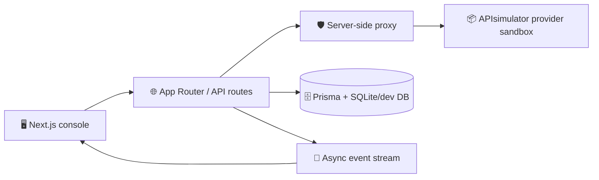

# APIsimulator - Provider Operations Console

<p align="center">
  
</p>

> **Observe, inspect, and triage your sandbox API lifecycle - from initial request to async event.**

## Fun things you can do

- Watch an API call travel from click to database to async event - in real time
- Run the whole console in Demo Mode with zero API keys
- See the full lifecycle: Action, Request, Response, DB State, Event

## What It Does

APIsimulator makes the full API lifecycle visible in one place: Action → Request → Response → DB State → Async Event. It runs in Demo Mode with no API key, so you can evaluate the console before you ever have credentials.

## 📌 TL;DR

When integrating with an external financial/trading/provisioning API, the hard part is seeing what happened afterward. Provider Ops Console makes the whole chain visible in one place: Action → API Request → Response → Database State → Async Event. It runs in Demo Mode with no API key, so you can evaluate the console before you ever have credentials.

## 🏗️ Architecture - how the pieces talk



| Component | Responsibility | Key location |
|---|---|---|
| 🖥️ Console UI | Action/request/response/state/event views | app/, components/ |
| 🌐 API routes | Server-side request handling & validation | app/api/, lib/ |
| 🗄️ Prisma | Lifecycle/state persistence | prisma/ |
| 🎮 Demo mode | Runs without provider credentials | lib/, env/config |


## Features

- **5-stage lifecycle visibility** — Action → Request → Response → DB State → Async Event
- **Demo Mode** — zero API keys needed to start
- **Zod validation** — runtime type safety on all API boundaries
- **Server-side proxying** — API keys never reach the browser
- **Fixed-point money** — amounts stored as strings, no floating-point surprises
- **Triage ladder** — severity-based issue classification

## 📋 The playbook - recreate from zero

### Phase 0 - Scope 🎯

1. One sentence: _"Make the full API lifecycle visible in one place."_
2. Boundaries: demo-first, no browser-exposed secrets, fixed-point money.

### Phase 1 - Skeleton 🦴

3. Next.js 15 + React 19 + Tailwind 4.
4. Prisma schema for core lifecycle models.

### Phase 2 - Lifecycle console 📊

5. Model Action → Request → Response → DB State → Async Event.
6. Zod validation at API boundaries.

### Phase 3 - Safety & ops 🛡️

7. Server-side proxying; keys never reach browser.
8. Triage ladder/severity model for operator review.

### Phase 4 - Ship 🚢

9. npm run build + lint; verify Demo Mode works with no credentials.


## 🚀 Provisioning

```bash
# Prereqs: Node.js 20+ (LTS), npm
git clone https://github.com/shahriarhaqueabir/APIsimulator.git
cd APIsimulator
npm install
cp .env.example .env   # if present; Demo Mode works without provider keys
```


## Quick Start

```bash
npm install
npm run dev
```

Open http://localhost:3000. The console runs in Demo Mode by default.

## 🧰 Stack

- Next.js 15, React 19, Tailwind 4
- Prisma (7 models), Zod
- Demo Mode (no API keys needed)
- Server-side proxying

## 📁 Project layout

```text
APIsimulator/
├── app/                    # Next.js app router
├── components/             # UI components
├── lib/                    # Shared utilities
├── prisma/                 # Database schema + migrations
├── public/                 # Static assets
└── scripts/                # Utility scripts
```

## 🔧 Verification

- `npm run build` — 0 errors
- `npm run lint` — ESLint clean
- Demo Mode works without any API credentials

## ⚠️ Mistakes to avoid

- **Trusting the docs over the live API.** Provider schemas drift. Dump the raw response and validate with Zod before trusting any field.
- **Exposing API keys to the browser.** All provider calls go through the server-side proxy. The browser never sees a key.
- **Storing money as floats.** Amounts are strings end-to-end. Floating point will silently corrupt balances.
- **Skipping Demo Mode.** It exists so you can evaluate the console before you have credentials. Use it.
- **Treating observability as a UI problem.** The data model comes first; the UI just renders it.

## 📌 Takeaways
- Demo mode with realistic seed data makes onboarding instant.
- Server-side proxying is the only safe place for API keys.
- Zod at the boundary turns "API drift" into a loud, early failure.
- Observability is a data model problem before it is a UI problem.
- Your system should look different from mine.

## 📜 License

MIT — see [LICENSE](LICENSE).

## 🔗 Links- Blog post: Provider Ops Console (coming soon)